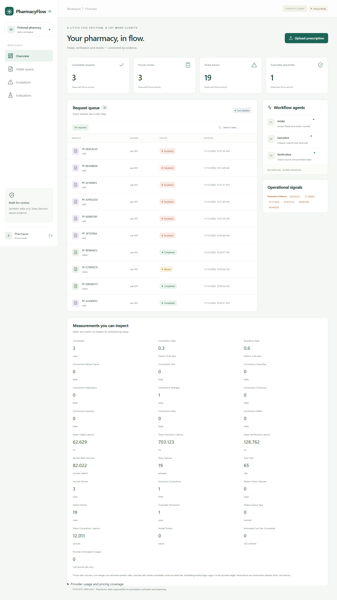

# PharmacyFlow AI

A runnable synthetic pharmacy workflow lab: prescription PDF/image intake, patient text/recorded-voice refills, three bounded agents, pharmacist review, and a separate mock pharmacy UI. **Synthetic patients, synthetic documents, simulated calls, mock records. Pharmacists retain responsibility for verification and dispensing. This app never authorizes dispensing.**



## Start

Full stack (Docker Compose v2):

```sh
python scripts/setup.py
docker compose up --build -d
```

Open **http://localhost:8000**. Sign in as `patient`, `staff`, `pharmacist` or `administrator` using `DEMO_PASSWORD` from the generated local `.env`. The separate mock ledger is **http://localhost:8001**, and Jaeger is **http://localhost:16686**. No model credentials are needed in the default fixture mode.

Without Docker, use Python **3.12**, Node 24 and uv:

```sh
uv sync --frozen --python 3.12
npm ci --prefix frontend
npm run build --prefix frontend
uv run python scripts/setup.py
# Install Chromium into the project (PowerShell equivalent shown below).
PLAYWRIGHT_BROWSERS_PATH=.tools/browsers uv run playwright install chromium
uv run python scripts/dev.py
```

PowerShell browser install: `$env:PLAYWRIGHT_BROWSERS_PATH = "$PWD\.tools\browsers"; uv run playwright install chromium`.

The local runner launches API, mock pharmacy, MCP and worker with SQLite persistence; Compose uses PostgreSQL/pgvector and includes observability services. Run `python scripts/doctor.py` to inspect your runtime. Machine-specific recovery notes are in `docs/PROGRESS.md`. If npm is absent, `python scripts/bootstrap_npm.py` installs its pinned CLI inside `.tools`; use `node .tools/npm/package/bin/npm-cli.js` in place of `npm`.

## Try the demo

1. Sign in as **patient**. Start a refill, optionally enabling “lose the response after a successful write.” Confirm fictional Avery Morgan, DOB `1988-04-12`, code `246810`, then explicitly select `rx-001`. The eventual status is recorded for pharmacist processing.
2. Sign in as **staff** and upload `fixtures/documents/scanned-uncertain.png`. Sign in as **pharmacist**, inspect the original beside its fields, correct `strength` to `10 demo-units`, save and approve the exact draft.
3. Upload `fixtures/documents/adversarial.png`. Its injected instructions are flagged; it stays at review and cannot call write tools or dispense.
4. Open the case timeline, policy citations and measurements. Sign into the separate mock ledger as a staff role to inspect saved requests.

The automated acceptance command actually kills and restarts its own worker after a successful UI write and lost response:

```sh
uv run python scripts/acceptance.py
```

It uses isolated local databases and ports 8010–8012; your demo cases are preserved. It also checks scanned correction, injection resistance, changed selectors, expired sessions, staff/patient screens and mobile layout. Reports and screenshots identify the actual run.

## Architecture

React/TypeScript → FastAPI/Pydantic → persistent leased jobs → LangGraph intake/execution/verification agents → permission-checked MCP tools → Playwright → separate mock pharmacy database. Application rules enforce tenant/patient access, identity confirmation, exact-action approvals and idempotency. PostgreSQL supplies application/audit data, checkpoints, full-text search and pgvector; local SQLite is a labeled fallback. OpenTelemetry links redacted actions by case ID, with local trace files and a Compose Jaeger viewer.

See [architecture](docs/ARCHITECTURE.md), [nine-area coverage](docs/COVERAGE.md), [OWASP controls and gaps](docs/SECURITY.md), [deployment/rollback](docs/DEPLOYMENT.md) and [resumption notes](docs/PROGRESS.md).

## Models and voice

Copy/edit `.env.example` through `scripts/setup.py`. `PROVIDER_MODE=fixture` uses deterministic text extraction, known scan hashes and simulated transcription. Unknown images preserve null values for manual review. Browser speech synthesis reads fixture responses.

For live mode set `PROVIDER_MODE=live` and `OPENAI_API_KEY`. Text, vision, embeddings, STT, TTS and judge models are independent environment settings. Run `python -m pharmacyflow.reindex` after changing embedding providers/models. Microphone input uses `MediaRecorder`, uploads real audio for transcription, requires explicit identifier/prescription confirmation, and plays generated MP3 responses. Use localhost or HTTPS. This is recorded-turn voice, not duplex telephony. Configured model availability must be verified with your provider account.

Live text/vision token counts are recorded; cost uses your configured rates and is explicitly an estimate. A persistent usage ledger includes speech, embeddings and judge calls; unavailable usage/rates are explicit, not treated as zero. Configure `PRICING_VERSION` and applicable rates. All paid calls require `LIVE_TOTAL_BUDGET_USD` and a conservative `LIVE_CALL_RESERVATION_USD`; live evaluation also requires `--budget-usd`. No live model, audio, embedding or judge calls were made during local verification.

## Verify and evaluate

```sh
uv run pytest -q --junitxml reports/tests.xml
uv run python scripts/acceptance.py
uv run python -m evaluation.run --trials 3
uv run python -m evaluation.retrieval
uv run python scripts/validate_deployment.py
```

The preserved original and additional v2 workflow suites each have **60 scenarios**, **3 trials**, and both architectures (**360 runs per suite; 720 total**). A separate 60-document extraction-only suite runs two trials. It measures extraction before scripted pharmacist correction, identity matching, retrieval, citations, persisted transactions, policy adherence, duplicate prevention, consistency, latency and estimated cost. Full evaluations use real application/agent/database code with explicitly simulated MCP/UI transport; acceptance separately uses real MCP and Chromium. The single-agent baseline has the same tool capability set and mandatory application safeguards. Judge rubric v1 and an attributable human-review screen are included; calibration is **pending** until independent human labels and live judge scores exist.

Measured reports are in [reports](reports/); current results and limitations are summarized in [RESULTS.md](docs/RESULTS.md). The original fixture evaluation passed expected workflow outcomes in both architectures with **69.4% field accuracy before corrections**; the additional v2 suite also passed expected workflow outcomes with **47.2% field accuracy before scripted corrections**, zero provider tokens/cost, and no demonstrated multi-agent quality gain. Historical retrieval used 20 queries. The expanded current set measures **90% recall@3** across 40 positive queries, **65% abstention** across 20 negative queries, and **100% citation integrity**. Keyword-overlapping off-topic queries remain a measured weakness. These are synthetic fixture results, not live-model benchmarks or clinical accuracy claims.

## Limits

Docker is not installed on the verification host: Compose image execution, PostgreSQL/pgvector/checkpoints and Jaeger startup remain locally unverified. Static configuration checks are available; CI includes a separate PostgreSQL Compose job but has not been run remotely. Cloud provisioning, DNS/HTTPS, live providers and judge calibration need external credentials/resources. The cloud override disables shared demo accounts and requires individual accounts; MFA/managed identity remain absent. The single-host topology and simplified pending-request lifecycle are not production pharmacy integrations.

## Continuation commands and evidence

Existing data is preserved by additive migrations 002–004. Run `uv run alembic upgrade head` before restarting services. Original reports are archived in `reports/historical/original-v1`; current reports carry their own run/configuration information. See [audit and remaining gaps](docs/GAPS.md).

```sh
uv run python -m evaluation.run --dataset evaluation/heldout-v2.json --trials 3
uv run python -m evaluation.unseen
uv run python -m evaluation.run --live --dataset evaluation/heldout-v2.json --budget-usd YOUR_APPROVED_LIMIT
uv run python -m evaluation.unseen --live --budget-usd YOUR_APPROVED_LIMIT
uv run python scripts/acceptance.py --postgres
```

The PostgreSQL acceptance command requires a test PostgreSQL server configured in DATABASE_URL and permission to create isolated test databases. It uses actual PostgreSQL checkpoints, MCP and Chromium, including worker interruption. Docker is unavailable on this host, so that level remains unexecuted here. Live commands emit explicit skipped reports without credentials and budget. Human judge calibration remains pending.

New review controls show per-field change history, explicit ambiguous-patient resolution and rejection, and expire exact-draft approvals. Unseen content is prepared page by page; known scan hashes live only in the fixture test adapter. Model confidence is explicitly uncalibrated.

For a public synthetic demo, use the cloud override (DEMO_MODE=false) and provision separate users:

```sh
docker compose exec api python -m pharmacyflow.accounts reviewer-name --tenant demo --role pharmacist
docker compose exec api python -m pharmacyflow.accounts patient-name --tenant demo --role patient --patient-id pat-001
```

Passwords are prompted, never placed on the command line. The account's role and tenant are resolved server-side; logout revokes its sessions.

## Comparison and next priorities

See [competitive review and improvement roadmap](docs/COMPETITIVE_REVIEW.md) for a source-linked comparison with related public repositories, measured weaknesses, and acceptance criteria for the next improvements.
