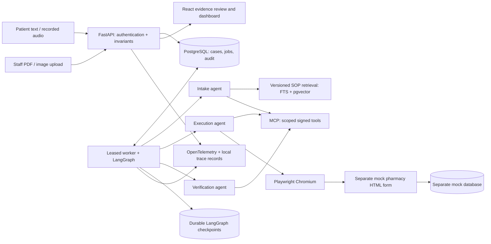

# Architecture and trust boundaries

PharmacyFlow is a synthetic-data workflow laboratory. It records draft intakes and refill requests for pharmacist processing. It never verifies a real prescription, dispenses, or gives medication advice.

## Runtime and persistence

The default deployment uses PostgreSQL 17 with pgvector. Alembic creates application tables, policy full-text/vector indexes, and an independently initialized mock database. LangGraph's PostgreSQL checkpointer stores execution snapshots. The local no-Docker path explicitly uses SQLite WAL, SQLite checkpoints, and lexical/vector ranking in Python. It does **not** claim to exercise PostgreSQL.

Application state is authoritative. Each graph invocation performs one durable state transition; checkpoints contain case ID, state, and revision rather than prescription text. Human steps end a worker lease and resume when a pharmacist or patient supplies the required input. A revision check prevents a stale worker response from overwriting a human change. Transactions use unique idempotency keys and a unique pending action digest in the mock database.

Queue claims are conditional SQL updates; PostgreSQL and SQLite compete for the same lease. Heartbeats extend a running lease. Interruption leaves durable state for another worker to reclaim. Retries are bounded, exponentially delayed, and escalated after exhaustion. Waiting workflows expire. An expired workflow with a possible external write is reconciled before being marked timed out. Cancellation is rejected once execution may have started because cancelling the workflow cannot undo a persisted pharmacy request.

## Agent responsibilities

| Component | Typed contract | Allowed tools | Decision boundary |
|---|---|---|---|
| Intake | `AgentInput` → `AgentOutput`; `Extraction` and evidence | patient lookup, prescription lookup, task status | Exact identity and prescription matching; draft preparation |
| Execution | `AgentInput` → `AgentOutput`; `Action` | request status, transaction preparation, task status | Reconcile before writing; visible UI save and readback |
| Verification | `AgentInput` → `AgentOutput` | patient/prescription lookup, request status, task status | Exact action, patient, source resolution, approval and final state |
| Single-agent baseline | Same state/data contracts | Union of the same tool capabilities | One controller identity; skips independent source and prescription rechecks, retains mandatory application invariants |

These are bounded workflow agents, not open-ended autonomous agents. The fixture mode is deterministic. Live adapters supply extraction, intent classification, embeddings and audio. Models cannot approve actions or directly invoke tools. Multi-agent fixture parity is a result, not evidence of improved real-model reasoning.

## Authorization

JWT sessions are issued after Argon2 password verification. Role, tenant and patient scope are resolved from the database on every application request. Browser sessions never receive the application signing secret. MCP tools use short-lived signed worker capabilities bound to agent, tenant, patient and case. Mock UI tokens additionally bind the exact action digest and write permission. Service endpoints are internal in Compose; only the application, mock landing page and trace viewer are bound to host loopback.

Approval binds a pharmacist identity to the canonical JSON action SHA-256. Corrections invalidate that approval. Missing, uncertain, conflicting or unsupported-source fields must be explicitly corrected before approval. All intake drafts require review, including apparently clear ones. Refills require explicit synthetic identity and prescription confirmation. No operation authorizes dispensing.

## Evidence and retrieval

PDF extraction supports text evidence with page numbers. Fixture scans are recognized by content hash and return labeled known evidence; unknown images return nulls for manual review. Live vision renders PDF pages and requests schema-validated field evidence. Supporting text is retained even after correction. Evidence is an assertion to inspect, not proof that a vision model is correct.

Fictional SOPs are version-controlled in `fixtures/policies/v1.json`. Tenant and version are filtered before ranking. Released corpus digests are recomputed from the source file, so replacing a database passage and its stored digest does not make it trusted. Missing or modified passages fail closed. PostgreSQL combines full-text rank and vector similarity with reciprocal rank fusion. Fixture vectors use 64-dimensional feature hashing. Live embedding changes require `python -m pharmacyflow.reindex`; changing a model without reindexing fails closed.

## Observability and data lifecycle

Each attributable audit event records case correlation, actor, transition reason and an allowlisted evidence summary. OpenTelemetry span IDs link to local `data/traces.jsonl` and, in Compose, Jaeger. Raw document text, identity values, JWTs and audio do not enter traces. Raw Playwright network traces are intentionally not retained because they contain capabilities; sanitized browser action/readback events appear in the timeline.

Metrics derive from stored cases/events, including elapsed human-wait time. The dashboard links measurements to contributing cases. Fixture model tokens and estimated provider cost are zero. Live text/vision token estimates use configured rates; speech and embedding billing are explicitly excluded. Alerts expose stalled cases, repeated errors and an estimated-cost threshold. Retention has a dry run and deletes expired terminal case documents, checkpoints, audit details and mock requests; it leaves minimal attributable purge events. Run it as an administrator maintenance task.
